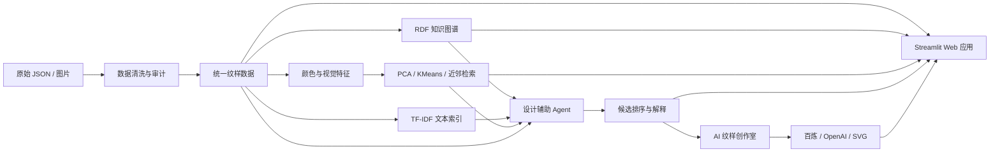

# 基于本体知识图谱与多模态检索的中国传统纹样设计辅助智能体

> 刘天伊 3240102451

- 代码仓库：`待上传 GitHub 后填写仓库链接`
- 在线演示：`待部署 Streamlit Community Cloud 后填写访问链接`

---

## 摘要

本项目面向中国传统纹样的检索、分析与设计辅助需求，开发了一套可本地运行的交互式 Web 应用。系统以《中国传统纹样图鉴》的公开数据为基础，将结构化检索、RDF 知识图谱、TF-IDF 文本检索、图像颜色特征、PCA 降维、KMeans 聚类、近邻检索以及可解释的设计推荐流程整合到同一应用中。用户可以浏览和筛选纹样、查询纹样之间的知识关系、分析图片的颜色与聚类分布，并通过自然语言描述设计需求，由 Agent 调用多个真实工具完成候选搜索、证据检索、视觉匹配与综合排序。

第二阶段进一步实现“AI 纹样创作室”。用户可以将检索或推荐得到的纹样作为设计参考，设置主题、风格、配色和应用场景，通过阿里云百炼通义万相或 OpenAI Images API 生成新的纹样设计稿；在没有 API 密钥或网络服务时，也可以使用本地程序化 SVG 生成器。系统对数据集图片、检索参考、AI 生成图和程序化生成图进行明确标注，并保存生成参数和参考纹样 ID。

当前正式数据集包含 100 条纹样记录和 100 张可用图片，生成 2218 条 RDF 三元组和 900 个可检索文本片段。视觉分析使用 100 张图片，默认 KMeans 聚类数为 3，三个簇的样本数分别为 55、22 和 23，轮廓系数为 0.316208。项目完整自动化测试共 52 项，当前全部通过。

**关键词：** 中国传统纹样；知识图谱；多模态检索；设计智能体；图像生成；Streamlit

---

## 1. 项目背景

中国传统纹样包含丰富的造型结构、文化寓意、色彩特征和应用信息，但公开资料通常以图片、网页说明或分散字段的形式存在。设计者在进行主题构思时，往往需要分别完成图片浏览、资料检索、风格判断和配色分析，信息获取成本较高。

传统关键词搜索只能处理名称或描述文本，难以同时利用图片颜色、纹样类别、应用载体和纹样间关系。纯生成式模型虽然可以快速输出图像，却不一定能够说明参考来源，也难以证明推荐结果来自真实数据。因此，本项目选择“真实数据检索 + 知识关系组织 + 视觉分析 + 可解释推荐 + 生成式创作”的组合路径，构建一个面向设计流程的数字工作台。

## 2. 项目目标

项目主要实现以下目标：

1. 建立统一、可追溯的传统纹样数据模型，保留原始 ID、图片路径、来源和许可信息。
2. 提供关键词与结构化条件组合检索，支持纹样图鉴式浏览。
3. 使用 RDFLib 构建由真实数据生成的传统纹样知识图谱。
4. 提取图像颜色特征，实现 PCA、KMeans、聚类评价和视觉近邻检索。
5. 使用 TF-IDF 建立带来源的本地文本知识库。
6. 实现确定性的设计辅助 Agent，展示工具调用轨迹、分项得分和推荐理由。
7. 接入真实图像生成 Provider，实现从“检索参考”到“新纹样创作”的完整流程。
8. 通过自动化测试、数据审计和异常处理保证系统可以稳定演示和复现。

## 3. 数据来源与数据治理

### 3.1 基础数据源

项目的正式基础数据来自《中国传统纹样图鉴》公开仓库：

- 仓库地址：<https://github.com/dososo/chinese-traditional-patterns>
- 正式记录数：100
- 类别数：6
- 本地可用卡片图：100
- 图片与文字许可：CC BY-NC 4.0
- 代码与数据结构许可：MIT

项目保留每条记录的原始编号、来源文件路径、来源 URL 和许可证字段。原始数据保存在 `data/raw/`，清洗后的数据与特征缓存保存在 `data/processed/`，处理过程不会覆盖原始文件。

项目同时核查了 Hugging Face 上的 Traditional Pattern Dataset，并实现了要求官方图片—JSON 映射 CSV 的导入器。由于该数据集第二阶段存在多张图片共享一份标注的情况，导入器严格按官方映射逐行建立图片记录，不使用名称相似度猜测映射，也不自动与基础数据源中的同名纹样合并。

### 3.2 统一数据模型

系统统一字段包括：

| 字段 | 含义 |
|---|---|
| `pattern_id` | 系统内稳定纹样 ID |
| `name` / `name_en` | 中文名与英文名 |
| `category` | 纹样类别 |
| `historical_period` | 历史时期 |
| `cultural_meaning` | 文化寓意描述 |
| `application_context` | 常见应用载体 |
| `visual_keywords` | 视觉关键词 |
| `image_path` | 本地图片路径 |
| `source_name` / `source_url` | 数据来源及链接 |
| `license` | 使用许可 |
| `related_patterns` | 明确关联的纹样 ID |

清洗流程会检查空值、重复 ID、图片路径、图片可解码性和字段覆盖率。当前数据审计结果为：100 条正式记录、100 张可用图片、0 张缺失图片、0 个重复 ID。

## 4. 系统架构

系统按照数据、知识、检索、视觉、Agent、生成和界面分层实现：



主要工程目录如下：

```text
app.py                 Streamlit 主应用
src/data/               数据读取、清洗和审计
src/ontology/           RDF 本体、图谱生成与查询
src/retrieval/          TF-IDF 文本知识检索
src/vision/             图像特征、PCA、聚类与近邻
src/agent/              需求解析、工具编排和候选排序
src/generation/         图像生成 Provider 与结果保存
data/raw/               原始数据
data/processed/         清洗数据和特征缓存
data/generated/         生成图及参数文件
tests/                  自动化测试
docs/                   审计、架构、演示与项目文档
```

## 5. 核心功能

### 5.1 纹样图鉴与结构化搜索

图鉴页面以卡片网格展示图片、名称、类别和摘要，支持关键词、类别、历史时期、文化寓意和应用场景组合筛选。详情区域展示完整字段、关联纹样、数据来源和许可。筛选条件会真实作用于 DataFrame，而不是使用预先写死的结果。

### 5.2 RDF 知识图谱

系统定义 `Pattern`、`HistoricalPeriod`、`MotifCategory`、`CulturalMeaning`、`ApplicationContext`、`VisualFeature` 和 `Source` 等核心实体，并建立 `hasPeriod`、`hasCategory`、`hasMeaning`、`suitableFor`、`hasVisualFeature`、`relatedTo` 和 `supportedBySource` 等关系。

图谱由当前清洗数据动态生成，共包含 2218 条 RDF 三元组。用户可以按纹样名称、类别和寓意查询关系，并在界面中查看纹样与类别、寓意、应用场景和来源之间的连接。

### 5.3 视觉特征与机器学习分析

系统使用 Pillow 和 NumPy 对图片进行统一处理，提取：

- RGB 颜色直方图；
- RGB 均值与标准差；
- HSV 均值；
- 主要颜色；
- 基础轮廓指标。

特征向量用于三类任务：

1. 使用 PCA 将高维视觉特征投影到二维，生成可交互的“纹样星图”；
2. 使用 KMeans 对图片视觉特征聚类，并用轮廓系数评价聚类效果；
3. 使用欧氏距离执行近邻检索，支持选择已有纹样或上传图片查找视觉相似纹样。

当前分析样本数为 100，默认 `k=3`，簇规模为 55、22、23，轮廓系数为 0.316208。聚类结果用于描述图片视觉特征分布，不作为历史时期或文化类别结论。

### 5.4 文本知识库与检索

系统从纹样汇总信息和详情资料中构建 900 个文本片段，每个片段保留文档名称、来源路径、来源 URL 和关联纹样 ID。检索层使用字符 1—3 gram TF-IDF 表示中文文本，根据余弦相似度返回最相关的资料片段。

这种方案无需在线语言模型或模型下载，启动稳定、计算成本较低，并且能够返回可查看的原始来源。

### 5.5 设计辅助 Agent

设计辅助 Agent 使用确定性工具链完成以下步骤：

1. `parse_design_request`：解析时期、载体、寓意、类别、视觉关键词和颜色需求；
2. `search_patterns`：执行结构化候选搜索；
3. `query_knowledge_graph`：查询候选的图谱关系；
4. `retrieve_cultural_evidence`：从文本知识库检索相关资料；
5. `find_visual_neighbors`：根据真实图像特征查找视觉近邻；
6. `rank_candidates`：计算分项得分并生成推荐解释。

默认综合评分公式为：

```text
综合得分 = 0.55 × 结构化匹配分
         + 0.30 × 文本证据相关分
         + 0.15 × 视觉相似分
```

用户可以在页面中调整权重。每条推荐会显示综合分、三个分项得分、匹配条件、未满足条件、数据完整度、证据来源和风险提示。缺失字段不计为匹配，实际候选不足时按真实数量返回。

### 5.6 AI 纹样创作室

创作室允许用户设置纹样主题、风格、配色、应用场景和补充要求，也可以从图鉴或 Agent 推荐结果中选择一条纹样作为创作参考。提示词包含用户明确要求以及参考纹样中可追溯的视觉关键词、来源和许可信息，但不会上传整个本地数据集。

图像生成层采用统一 Provider 接口，目前包括：

- **阿里云百炼通义万相**：提交异步文生图任务、轮询任务状态、下载并验证生成图片；
- **OpenAI Images API**：作为可选在线 Provider；
- **程序化 SVG**：无需密钥和网络的本地几何纹样生成器。

API Key 仅从环境变量或 `.streamlit/secrets.toml` 读取，不写入代码和生成记录。生成成功后，系统保存图片和同名 JSON 参数文件，记录 Prompt、Provider、模型、尺寸、设计参数和参考纹样 ID。生成结果不会自动加入正式纹样数据、知识图谱或文本知识库。

## 6. Web 界面设计

应用采用现代东方文化数字工作台的视觉风格：温润米白作为背景、墨色作为正文、低饱和灰作为辅助色、朱砂红作为强调色。页面统一了标题层级、卡片间距、圆角、按钮、表格、指标卡片、图表和提示信息。

应用包含以下页面：

1. 项目首页；
2. 纹样图鉴与详情；
3. 知识图谱浏览；
4. 视觉分析与纹样星图；
5. 设计辅助智能体；
6. AI 纹样创作室；
7. 数据与方法说明。

## 7. 验证与改进

### 7.1 数据扩充与质量改进

项目早期仅有 8 张预览图片。通过核对上游仓库结构、固定提交版本和图片哈希，最终补齐 100 张正式卡片图。扩充后重新计算了全部视觉特征、PCA、KMeans 和轮廓系数。当前 100 条记录全部具有可用图片。

### 7.2 推荐逻辑改进

推荐逻辑按字段维度检查匹配关系。例如，时期条件只检查 `historical_period`，载体条件只检查 `application_context`，避免某个关键词在摘要中偶然出现而被错误计为匹配。未知字段不会获得匹配分，并会进入未满足条件或风险提示。

### 7.3 自动化测试

测试覆盖以下内容：

- 数据导入、字段规范化、缺图和重复 ID；
- Hugging Face 官方一对多映射；
- RDF 图谱生成与核心关系查询；
- 图像特征、损坏图片和视觉近邻；
- TF-IDF 文本检索和来源返回；
- Agent 完整匹配、时期缺失、无候选和无证据场景；
- 推荐排序、理由、分项得分和工具调用链；
- 提示词构建、输入校验和生成结果标注；
- 百炼与 OpenAI Provider 的成功、失败、超时和无密钥分支；
- 程序化 SVG 与生成参数保存；
- Streamlit 各页面渲染和主要按钮。

当前完整测试命令与结果：

```powershell
python -m pytest -q
# 52 passed
```

## 8. 运行与部署

### 8.1 本地运行

建议使用 Python 3.11 或更高兼容版本：

```powershell
python -m pip install -r requirements.txt
python scripts/build_data.py
python -m pytest -q
python -m streamlit run app.py
```

浏览器访问终端输出的本地地址，通常为 <http://localhost:8501>。

如需启用阿里云百炼，可在本机创建 `.streamlit/secrets.toml`：

```toml
DASHSCOPE_API_KEY = "你的百炼 API Key"
```

没有 API Key 时，图鉴、图谱、视觉分析、Agent 推荐和程序化 SVG 均可正常使用。

### 8.2 在线部署

项目可以通过 GitHub 仓库连接 Streamlit Community Cloud。部署入口文件为 `app.py`，依赖由 `requirements.txt` 安装。API Key 应填写在云端应用的 Secrets 设置中，不能提交到 GitHub。

完整上传和部署步骤见：[GitHub 与在线部署指南](GitHub与在线部署指南.md)。

## 9. 项目特点

1. **数据可追溯：** 推荐卡片保留来源、原始 ID 和许可信息。
2. **多模态融合：** 同时使用结构化字段、RDF 关系、文本资料和视觉特征。
3. **结果可解释：** 展示工具调用轨迹、分项得分、匹配项和未满足项。
4. **真实计算：** 搜索、TF-IDF、PCA、KMeans、近邻和排序均由当前数据实时计算。
5. **离线可用：** 核心检索与分析不依赖在线模型，API 不可用时仍能完成主要演示。
6. **生成闭环：** 推荐结果可以直接成为创作室参考，实现从资料检索到设计生成的连续流程。
7. **工程验证：** 使用缓存、异常处理和 52 项自动化测试保障稳定性。

## 10. 当前限制与后续工作

- 当前正式数据规模为 100 条，后续可以在保持官方映射关系的前提下扩展第二数据源。
- 基础数据的历史时期字段覆盖有限，因此系统不会根据名称自动补写时期。
- 颜色直方图容易受到卡片背景和版式影响，后续可以增加前景分割或本地图像语义特征。
- 在线图像生成依赖服务商网络、账户额度和模型可用性，现场展示应准备已生成成果或录屏作为备用。
- 后续可以增加用户收藏、方案对比和可编辑纹样排版功能。

## 11. 结论

本项目完成了一套可以真实运行和演示的传统纹样设计辅助智能体。系统从公开纹样数据出发，建立了统一数据模型、RDF 知识图谱、文本知识库和视觉特征索引，并通过可解释 Agent 将结构化检索、知识查询、文本证据和视觉近邻组织成完整推荐流程。在此基础上，AI 纹样创作室进一步连接了真实图像生成服务，使项目形成“浏览—分析—推荐—创作—下载”的完整闭环。

项目不仅展示了 Python 数据处理、机器学习、知识图谱和 Web 开发能力，也重点解决了设计类智能应用中的来源追踪、结果解释、服务降级和可复现验证问题。

## 参考资料

1. 《中国传统纹样图鉴》公开仓库：<https://github.com/dososo/chinese-traditional-patterns>
2. Traditional Pattern Dataset：<https://huggingface.co/datasets/BaoWenwen/Traditional-Pattern-Dataset>
3. Streamlit Documentation：<https://docs.streamlit.io/>
4. RDFLib Documentation：<https://rdflib.readthedocs.io/>
5. scikit-learn Documentation：<https://scikit-learn.org/stable/>
6. Plotly Python Documentation：<https://plotly.com/python/>
